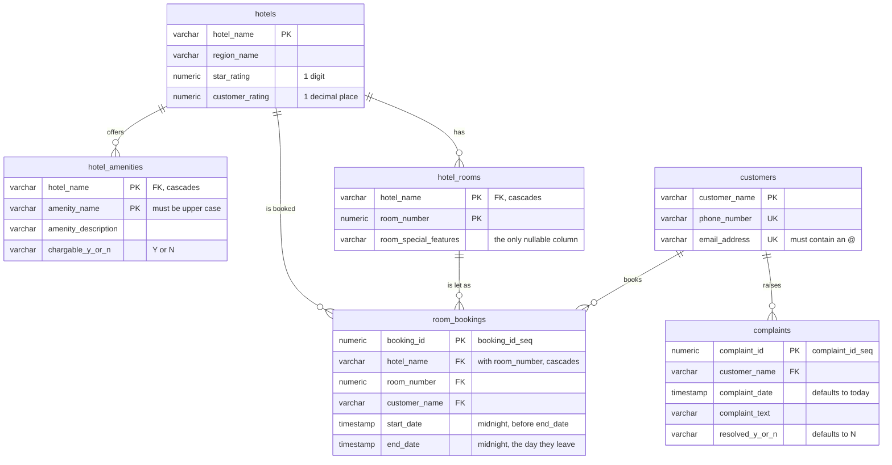

# mcpdbwizard-demo-postgres

A demo PostgreSQL schema for [MCPDBWizard for Postgres](https://mcpdbwizard.com/docs/postgres/):
a small hotel booking database with enough tables, views, constraints and functions to show a
generator that turns a schema into an MCP server.

You point MCPDBWizard at a schema and select the objects you are willing to expose, and it
generates an MCP server that has tools for those objects and nothing else. Objects you did not
select are absent from the generated server rather than blocked at request time:
[the config is the security model](https://mcpdbwizard.com/docs/configs/). This repository is
the other half of that exercise: the schema to point it at, plus two saved configs that already
make the interesting choices.

It is the PostgreSQL port of the Oracle demo in
[mcpdbwizard-demo](https://github.com/srmadscience/mcpdbwizard-demo): the same hotels, rooms,
customers and bookings, and the same two configs.

## Contents

| File | Purpose |
| --- | --- |
| `db/mcp_db_demo_user.sql` | Creates the `mcpdemo` login role. Run once, as a superuser |
| `db/mcp_db_demo_ddl.sql` | Schemas, tables, indexes, views, sequences, `upsert_customer`, `hotel_occupancy`, and the `room_manager` and `customer_portal` routines |
| `db/mcp_db_demo_dml.sql` | Sample data: 10 hotels, 21 amenities, 52 rooms, 43 customers, 92 bookings, 7 complaints |
| `db/mcp_db_demo_drop.sql` | Drops everything the DDL creates |
| `sql/*.sql` | Four of the hand-written queries exposed as tools, one file per tool, for reading. The config carries its own copy of every statement |
| `config/mcpdemo.json` | A saved config for a **staff** agent: which objects to expose, and how |
| `config/mcpdemo_customer.json` | A second config for a **customer-facing** agent: [Context Pinning](https://mcpdbwizard.com/docs/context-pinning/), one customer per connection, chosen by the URL |

Tested on PostgreSQL 16, 17 and 18, the versions MCPDBWizard for Postgres supports.

## Installing

Create a database for it (or use one you have), then:

```sh
psql -h <host> -U postgres -d hoteldemo -f db/mcp_db_demo_user.sql   # once, as a superuser
psql -h <host> -U mcpdemo  -d hoteldemo -f db/mcp_db_demo_ddl.sql
psql -h <host> -U mcpdemo  -d hoteldemo -f db/mcp_db_demo_dml.sql
```

The user script creates a login role `mcpdemo` with the password `mcpdemo`. Change it for
anything but a demo on your own machine. The DDL creates three schemas owned by `mcpdemo`:

| Schema | Holds | Oracle equivalent |
| --- | --- | --- |
| `mcpdemo` | The tables, views, sequences, `upsert_customer` and `hotel_occupancy` | The `MCPDEMO` schema |
| `mcpdemo_room_manager` | `getroomlist` and `bookroom`, for staff | The `ROOM_MANAGER` package |
| `mcpdemo_customer_portal` | `my_details`, `my_bookings`, `book_rooms`, `cancel_booking`, `my_complaints`, `add_complaint`, for one customer | The `CUSTOMER_PORTAL` package |

There are no migrations. This is demo data, so to start again, drop it and build it again:

```sh
psql -h <host> -U mcpdemo -d hoteldemo -f db/mcp_db_demo_drop.sql
psql -h <host> -U mcpdemo -d hoteldemo -f db/mcp_db_demo_ddl.sql
psql -h <host> -U mcpdemo -d hoteldemo -f db/mcp_db_demo_dml.sql
```

## Running MCPDBWizard against it

[Quickstart: Postgres](https://mcpdbwizard.com/docs/quickstart-postgres/) has the full version.
Pointed at this schema, the container looks like this:

```sh
docker run -d --name mcpdbwizard-postgres \
  -p 8080:8080 \
  -v mcpdbwizard-data:/data \
  -e MCPDBWIZARD_DB_HOST=your.db.host \
  -e MCPDBWIZARD_DB_NAME=hoteldemo \
  -e MCPDBWIZARD_DB_USER=mcpdemo \
  -e MCPDBWIZARD_DB_OTHER_USER='mcpdemo%' \
  -e DB_PASS=mcpdemo \
  ghcr.io/srmadscience/mcpdbwizard-postgres:2.0.33
```

`MCPDBWIZARD_DB_OTHER_USER='mcpdemo%'` lists the two routine schemas alongside `mcpdemo` on the
Design pages. A database on the Docker host itself is `host.docker.internal`, not `localhost`.

Sign in at <http://localhost:8080> as `admin`; the first password is in
`/data/initial-admin-password` (`docker exec mcpdbwizard-postgres cat /data/initial-admin-password`).
Then upload `config/mcpdemo.json` on the Configs tab. Uploading saves it, with the connection
filled in from the container's settings, and the config carries the text of its SQL statements,
so there is nothing else to copy.

Press **Generate & run** on the Runtime page, issue a token on the Users page, and connect through
the proxy on 8080:

```sh
claude mcp add hotel --transport http http://localhost:8080/mcp/admin/mcpdemo \
  --header "Authorization: Bearer <id>.<secret>"
```

Then ask the agent to book a room. The tools for objects in `mcpdemo`, the login role's own
schema, have plain names (`upsert_customer`, `hotels_get_by_pk`); the routines in the other two
schemas carry the schema name (`mcpdemo_room_manager_bookroom`).

This config has `mcpHttpToken`, `mcpHttps` and `mcpOAuth` all set to `NO`, which is fine for a
demo on your own machine and not fine anywhere else. Every tool call commits, so bookings and
customers an agent creates stay in the database until you rebuild it.

### One customer per connection

`config/mcpdemo_customer.json` is the customer-facing version. None of its routines takes a
customer name; they read the customer from the connection URL instead, where the model cannot
see or change it:

```sh
claude mcp add hotel-suzy --transport http \
  "http://localhost:8080/mcp/admin/mcpdemo_customer?CUSTOMER_NAME=SUZY%20BISHOP" \
  --header "Authorization: Bearer <id>.<secret>"
```

MCPDBWizard sets the value for the length of each tool call, and the routines in
`mcpdemo_customer_portal` read it with `current_setting('mcp.customer_name', true)`. A
connection without `CUSTOMER_NAME` is refused, and one customer cannot see, book as or cancel
for another. Nothing needs installing in the database for this. The free tier runs one server
at a time, so stop `mcpdemo` before you start `mcpdemo_customer`.

## The schema

| Table | Holds |
| --- | --- |
| `hotels` | One row per hotel, with a region, a star rating and a customer rating |
| `hotel_amenities` | What each hotel offers, and whether it is chargeable |
| `hotel_rooms` | Room numbers, with optional notes on what makes a room unusual |
| `customers` | Customer name, phone number and email address |
| `room_bookings` | Who is in which room, between which dates |
| `complaints` | What a customer complained about, when, and whether it was resolved |



Every join is a real constraint. Deleting a hotel takes its rooms and amenities with it, and the
rooms take their bookings. Nothing cascades from `customers`, so a customer with a booking or a
complaint on file cannot be deleted until those go first.

Two views summarise the reference data: `hotel_regions` aggregates ratings by region, and
`hotel_amenities_summary` gives the percentage of hotels that charge for each amenity.

Customer names are stored in upper case and email addresses in lower case. Write through
`upsert_customer` and that is handled for you, along with readable messages for a duplicate
email or phone number.

The sample bookings deliberately include hotels that are sold out for parts of the range, so
occupancy and availability have something to report other than "yes, there is a room".

## How it differs from the Oracle demo

- Oracle's packages are schemas here, so a routine is `mcpdemo_room_manager.bookroom` rather
  than `ROOM_MANAGER.BOOKROOM`, and its tool is `mcpdemo_room_manager_bookroom`.
- `DATE` columns are `timestamp(0)`, `NUMBER` is `numeric`, and PL/SQL's `NATURAL` is the domain
  `mcpdemo.dom_natural`.
- Context Pinning reads `current_setting('mcp.customer_name', true)` where Oracle reads
  `SYS_CONTEXT('MCP', 'CUSTOMER_NAME')`, and needs no context installed.
- The routines contain no `COMMIT`: each MCP tool call commits or rolls back on its own.
  `bookroom` undoes its own bookings when it cannot book every room asked for.

The header of `db/mcp_db_demo_ddl.sql` lists the rest.

## Licence

Apache License 2.0; see [LICENSE](LICENSE). MCPDBWizard itself is proprietary software from ATB
Consultancy Services Ltd: see <https://mcpdbwizard.com>.
